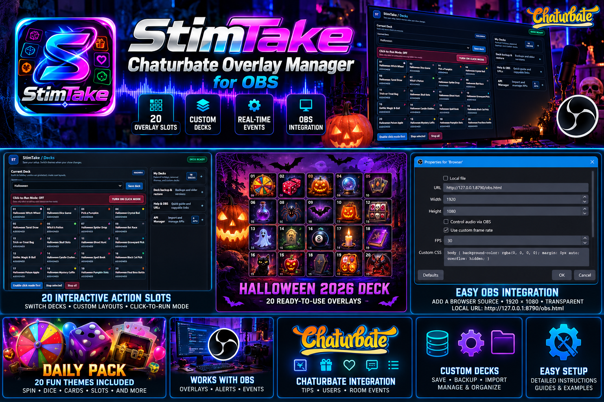
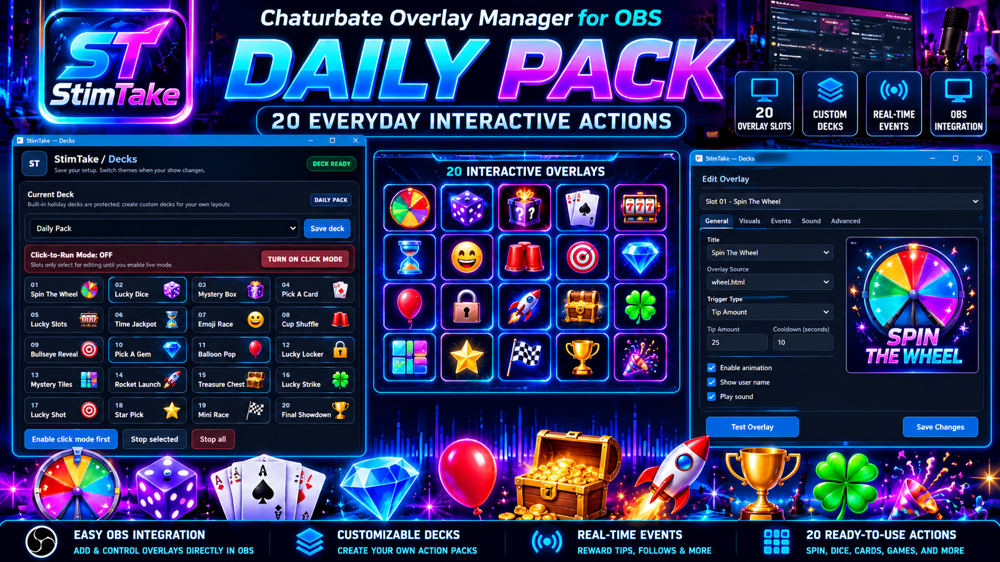

 <div align="center">

# StimTake — Chaturbate Overlay Manager for OBS

**A Windows toolkit for interactive OBS overlays, tip tracking, and customizable action packs.**


**[🌐 Project Website](https://tcdoverlord.github.io/StimTake-Overlay-Manager/)** · **[⬇️ Download StimTake for Windows](https://github.com/tcdoverlord/StimTake-Overlay-Manager/releases/latest/download/StimTake-Setup-1.0.0.exe)** · **[📦 GitHub Repository](https://github.com/tcdoverlord/StimTake-Overlay-Manager)** · **[🐛 Report an Issue](https://github.com/tcdoverlord/StimTake-Overlay-Manager/issues)**

</div>

## Table of Contents

- [Project Overview](#project-overview)
- [Action Packs](#action-packs)
- [Features](#features)
- [Requirements](#requirements)
- [Quick Start](#quick-start)
- [Using StimTake with OBS](#using-stimtake-with-obs)
- [Project Images](#project-images)
- [Troubleshooting](#troubleshooting)
- [Security and Privacy](#security-and-privacy)
- [Development and Contributions](#development-and-contributions)
- [Project Links](#project-links)
- [License and Attribution](#license-and-attribution)

---

## Project Overview

StimTake is a Windows toolkit for Chaturbate creators who want to add interactive actions and customizable visual experiences to OBS Studio. The project includes tools for managing action slots and decks, along with supporting overlays and resources.

The project includes a 20-slot action manager, customizable decks, overlay editing, and OBS integration workflows. Exact capabilities depend on the installed build and content.

StimTake is actively evolving. Check the current source, release notes, and included documentation to confirm the capabilities of a specific version.

## Action Packs

### Halloween 2026

<p align="center">
  <a href="https://github.com/tcdoverlord/StimTake-Overlay-Manager/blob/main/assets/stimtake-promo-banner.png">
    
  </a>
</p>

A seasonal, spooky-themed promotional pack. Available actions depend on the installed pack version.

### Daily Pack

<p align="center">
  <a href="https://github.com/tcdoverlord/StimTake-Overlay-Manager/blob/main/assets/daily-pack-banner.png">
    
  </a>
</p>

A collection of everyday interactive actions, including game-style overlays. The installed build determines which actions are available.

## Features

- **20 action slots** for organizing interactive actions.
- **Deck switching** to keep different action sets organized.
- **Custom decks** for personal layouts and show themes.
- **Overlay editing and assignment** for supported slots.
- **OBS integration workflows** for supported browser-source overlays.
- **Pack-based customization** for seasonal and everyday themes.

Feature availability depends on the current build and installed content. Not every overlay, event source, or integration is necessarily configured automatically.

## Requirements

- A supported Windows 10 or Windows 11 system.
- A StimTake build or installer.
- OBS Studio for displaying supported overlays.
- Any required browser-source URLs, local services, or pack files documented for the installed build.
- Internet access to download repository content or releases.

Requirements can vary by release.

## Quick Start

### 1. Get StimTake

**Recommended — install StimTake:** [Download StimTake for Windows](https://github.com/tcdoverlord/StimTake-Overlay-Manager/releases/latest/download/StimTake-Setup-1.0.0.exe). Download `StimTake-Setup-1.0.0.exe`, run it, and follow the setup wizard.

You can also visit the [Releases page](https://github.com/tcdoverlord/StimTake-Overlay-Manager/releases) to review release notes. Developers who want the source can clone the repository:

```powershell
git clone https://github.com/tcdoverlord/StimTake-Overlay-Manager.git
cd StimTake-Overlay-Manager
```

Review the included documentation and verify the version before running executables or scripts.

### 2. Launch the application

For a packaged Windows release, run the supplied installer or executable and follow the instructions included with that release.

For source builds, follow the repository's build instructions and scripts.

### 3. Choose an action pack

Open the deck or action-pack interface and select an available pack, such as Daily Pack or Halloween 2026, if installed in your build.

### 4. Configure and test an overlay

Select an action slot, review its overlay assignment and settings, and test it before using it live.

### 5. Add supported overlays to OBS

Use the URL or integration method documented by your installed build. A standalone HTML preview may not start the local application service by itself.

## Using StimTake with OBS

1. Open OBS Studio and select the scene where the overlay should appear.
2. Add a **Browser Source** if the selected overlay supports that workflow.
3. Enter the local URL or file path documented by your installed build.
4. Set the source dimensions for your scene.
5. Test the overlay and triggering workflow before streaming.

URLs, ports, and source settings can vary by build. Use the values provided by the running application rather than assuming a default endpoint.

## Project Images

The repository's `assets/` folder contains these images:

- `daily-pack-banner.png`
- `stimtake-promo-banner.png`
- `real-decks-dashboard.png`
- `real-obs-browser-source.png`
- `windows-stimtake-search.png`

Keep these files in `assets/` with the same filenames and capitalization so the README and website can display them correctly.

## Troubleshooting

### The application does not launch

- Check the release's requirements and instructions.
- Confirm that you installed or extracted the complete package.
- Run the executable from its expected location.
- Review any console output or error messages.

### An action or overlay does not appear

- Confirm the correct deck and slot are selected.
- Check that an overlay is assigned to the slot.
- Confirm the relevant pack is installed and supported.
- Test the overlay before using it live.

### OBS Browser Source is blank

- Verify that the required StimTake application or service is running.
- Confirm that the URL or file path matches the installed build's documentation.
- Refresh the Browser Source and review application output for errors.
- Remember that opening an HTML preview does not necessarily start a local backend service.

### A pack or image is missing

- Confirm the pack was installed or imported correctly.
- Check filenames, paths, and capitalization.
- Confirm the relevant asset is committed to GitHub at the referenced location.

## Security and Privacy

- Prefer downloads from the official repository.
- Review scripts before running them, especially development builds.
- Do not commit credentials, API keys, private configuration files, or personal data.
- Test integrations and event-triggered actions before relying on them live.
- Keep Windows, OBS, and project dependencies updated.

## Development and Contributions

Bug reports, documentation improvements, reproducible tests, and focused code contributions are welcome.

When reporting a problem, include the StimTake version, Windows version, relevant error output, and steps to reproduce it. Remove credentials and personal information from logs before posting.

- [Open an issue](https://github.com/tcdoverlord/StimTake-Overlay-Manager/issues)
- [View pull requests](https://github.com/tcdoverlord/StimTake-Overlay-Manager/pulls)

## Project Links

- **Repository:** https://github.com/tcdoverlord/StimTake-Overlay-Manager
- **Download for Windows:** https://github.com/tcdoverlord/StimTake-Overlay-Manager/releases/latest/download/StimTake-Setup-1.0.0.exe
- **Releases:** https://github.com/tcdoverlord/StimTake-Overlay-Manager/releases
- **Issues:** https://github.com/tcdoverlord/StimTake-Overlay-Manager/issues
- **Project website:** https://tcdoverlord.github.io/StimTake-Overlay-Manager/
- **Maintainer:** https://github.com/tcdoverlord

## License and Attribution

Review the license files and notices in the repository and included dependencies before redistributing modified builds or bundled software. Do not assume that every component uses the same license.

---

<div align="center">

**Built by [TCDOVERLORD](https://github.com/tcdoverlord)**

*Interactive actions. Custom decks. OBS-ready workflows.*

</div>
